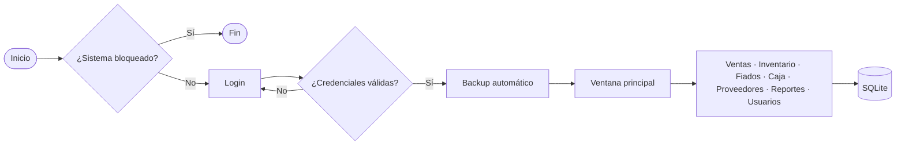

# ⚡ SANDUINO Energy ERP

**Sistema de gestión de escritorio para comercios pequeños y medianos.** Reúne en una sola aplicación las seis funciones que sostienen la operación diaria de un negocio: **vender, controlar stock, cobrar fiados, cerrar la caja, gestionar proveedores y analizar resultados**, con usuarios, auditoría y copias de seguridad.

> *"SANDUINO Energy convierte la operación diaria de un comercio en información ordenada, segura y disponible en segundos."*

Este repositorio contiene la documentación del sistema. El manual completo (64 páginas) está en [`docs/SANDUINO_Energy_ERP_Manual_Completo.pdf`](docs/SANDUINO_Energy_ERP_Manual_Completo.pdf).

---

## ¿Qué es y para qué sirve?

Muchos comercios chicos manejan su negocio con cuadernos, planillas o programas desconectados. Eso genera:

| Problema | Consecuencia |
|---|---|
| Stock desordenado | Ventas perdidas por quiebre y dinero inmovilizado por sobrecompra |
| Fiados sin control | Cobranzas olvidadas y conflictos con clientes |
| Caja con diferencias | Descuentos sin explicación y desconfianza |
| Sin trazabilidad | No se sabe quién vendió, borró o modificó algo |
| Sin respaldo | Un fallo del equipo puede borrar todo el historial |

SANDUINO Energy ocupa el espacio entre las planillas (gratis pero frágiles) y los ERP corporativos (potentes pero caros y complejos): se instala en una computadora común, **no necesita internet, servidor ni suscripción** y se aprende a usar en horas.

**A quién apunta:** comercios de energía y materiales eléctricos, ferreterías, casas de repuestos, kioscos, almacenes, minimercados y emprendedores que pasan de la planilla a su primer sistema.

## Los cuatro pilares

- **Integración:** todo el negocio en una herramienta, con módulos que comparten una misma base de datos.
- **Control:** stock mínimo, fiados con estado, arqueo de caja y auditoría.
- **Seguridad:** claves cifradas con SHA-256, roles, bloqueo de usuarios y backups.
- **Simplicidad:** interfaz con pestañas y tema oscuro, con flujos de pocos pasos.

## Módulos

| Módulo | Qué hace |
|---|---|
| **Punto de Venta** | Carrito, tres medios de pago (efectivo, tarjeta débito/crédito, transferencia / MP) y ticket PDF numerado por venta. Valida código, cantidad y stock disponible. |
| **Inventario** | Tabla visual del catálogo, stock mínimo por producto, estado OK/BAJO, alerta de stock crítico y exportación a Excel. |
| **Deudores / Fiados** | Reemplaza el cuaderno: cliente, monto, concepto y fecha, con estados `PENDIENTE` y `PAGADO`. |
| **Arqueo de Caja** | Movimientos manuales (apertura, ingreso, egreso) y cierre diario. |
| **Proveedores** | Agenda de proveedores con rubro y teléfono. |
| **Reportes** | Gráfico de ventas de los últimos siete días. |
| **Usuarios, Auditoría y Backups** | Roles Admin y Vendedor, bloqueo de cuentas, bitácora de acciones y copias de seguridad. Solo visible para el Admin. |

## Diagramas de flujo

El flujo general del sistema y los procesos clave (inicio de sesión, venta, inventario, cierre de caja y bloqueo global) están en [`docs/diagrama-de-flujo.md`](docs/diagrama-de-flujo.md). GitHub los dibuja directamente.



## Seguridad y control

- Contraseñas guardadas como **hash SHA-256**, nunca en texto plano.
- Roles **Admin** y **Vendedor**; solo el Admin administra usuarios y borra productos.
- **Bitácora de auditoría** con fecha, usuario y descripción de cada acción relevante (ventas, altas y bajas, cierres de caja, backups).
- **Backup automático** en cada inicio de sesión, más copia manual a pedido.
- Consultas SQL parametrizadas, que previenen la inyección de SQL.
- **Bloqueo global de emergencia** que inhabilita toda la aplicación desde un botón.

## Arquitectura y tecnología

Aplicación de escritorio **monolítica** en **Python**, con base de datos **SQLite** local (9 tablas). Sin servidores ni servicios externos.

| Capa | Componentes |
|---|---|
| Presentación | `customtkinter`, `tkinter/ttk`, `matplotlib` |
| Lógica de negocio | Validaciones, totales, descuento de stock, cierre de caja |
| Acceso a datos | `sqlite3` |
| Servicios | Hash de claves, backup, auditoría, tickets PDF (`reportlab`) |

Dependencias opcionales (el sistema arranca igual sin ellas): `pandas` y `openpyxl` (exportar a Excel), `matplotlib` (gráfico de ventas).

## Instalación rápida

Requisitos: Windows, macOS o Linux con entorno gráfico, y Python 3 con Tkinter (en Debian/Ubuntu: `python3-tk`). No requiere internet.

```bash
python -m venv venv
source venv/bin/activate        # Windows: venv\Scripts\activate
pip install customtkinter reportlab pandas openpyxl matplotlib
```

> ⚠️ **Ejecutar siempre desde la misma carpeta.** La app busca `sanduino_energy.db` por nombre relativo; si se lanza desde otra carpeta crea una base nueva y vacía, y parecerá que se perdieron los datos.

En el primer arranque se crea la base de datos y un usuario administrador inicial (credenciales en el capítulo 22 del manual). **Crealo propio y dejá de usar el inicial.** Una puesta en marcha completa lleva cerca de una jornada.

## Alcance de la versión actual

**Incluye:** los siete módulos descritos arriba, funcionamiento sin internet y exportación del inventario a Excel.

**No incluye todavía:**
- Factura fiscal / electrónica.
- Edición de productos ya cargados.
- Uso simultáneo desde varias computadoras (funciona sobre un archivo local de un solo puesto).
- Versión móvil o en la nube.
- Anulación de ventas y devoluciones.

Todas las limitaciones (L-01 a L-18) están listadas con su mitigación en el capítulo 27 del manual.

## Hoja de ruta

1. **Consolidación:** edición de productos, quitar líneas del carrito, validación numérica, cambio de clave, búsqueda por nombre, devoluciones y anulaciones.
2. **Gestión comercial:** facturación electrónica, lector de códigos de barras, compras a proveedores, cuentas corrientes, reportes por período, producto y vendedor.
3. **Escala:** versión en la nube, multi-sucursal, app móvil para el dueño, permisos personalizados e integración con medios de pago y contabilidad.

## Cuándo conviene (y cuándo no)

| Conviene | Conviene otra opción |
|---|---|
| La planilla ya se quedó chica pero un ERP corporativo sería excesivo | Se necesita facturación fiscal obligatoria desde el primer día |
| El dueño quiere control de usuarios sin infraestructura | Varias sucursales deben compartir datos en tiempo real |
| El negocio trabaja en una sola sede con una computadora principal | Se requiere acceso desde celulares o desde la nube |

## Qué hay en el manual

| Parte | Contenido |
|---|---|
| I. Visión y negocio | Propuesta de valor, mercado, casos de uso, retorno de inversión y comparativas |
| II. Producto | Cada pantalla, módulo y regla de negocio |
| III. Técnica | Arquitectura, modelo de datos (9 tablas), referencia del código y consultas SQL |
| IV. Instalación y operación | Instalación, manuales de usuario, backups y resolución de problemas |
| V. Calidad y evolución | Plan de pruebas, limitaciones, hoja de ruta y guía de extensión |
| VI. Feria y ventas | Guion de demo, objeciones frecuentes y plan de implementación |
| Anexos | Glosario, checklists imprimibles y formatos de registro |

## Estructura del repositorio

```
sanduino-energy-erp/
├── README.md
├── .gitignore
└── docs/
    ├── diagrama-de-flujo.md
    └── SANDUINO_Energy_ERP_Manual_Completo.pdf
```

## Autoría

David Santino Araujo · Manual del 1 de octubre de 2026.
