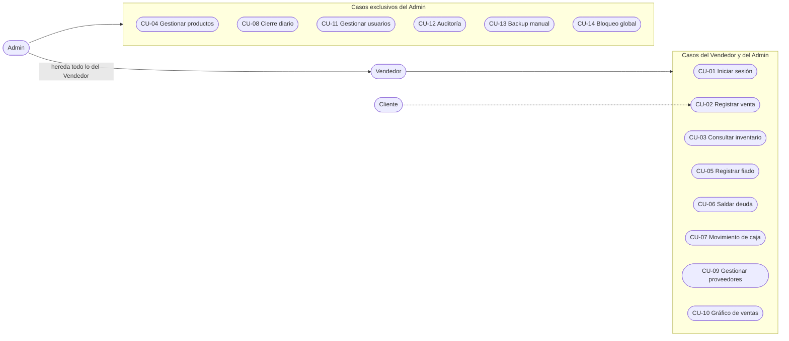

# Casos de uso de SANDUINO Energy ERP

## Actores

| Actor | Descripción |
|---|---|
| **Vendedor** | Atiende el mostrador: vende, anota fiados, registra movimientos de caja y consulta inventario y proveedores. |
| **Admin** | Dueño o encargado. Hace todo lo del Vendedor y además administra productos, usuarios, auditoría, backups y el bloqueo global. |
| **Cliente** | Actor secundario. Pide productos, paga y recibe el ticket; no opera el sistema. |

## Diagrama general

> El Admin hereda todos los casos del Vendedor (generalización). Todos los casos requieren haber iniciado sesión (CU-01).

## Resumen

| ID | Caso de uso | Actor principal | Módulo |
|---|---|---|---|
| CU-01 | Iniciar sesión | Vendedor / Admin | Acceso |
| CU-02 | Registrar venta | Vendedor / Admin | Punto de Venta |
| CU-03 | Consultar inventario y alertas | Vendedor / Admin | Inventario |
| CU-04 | Gestionar productos (alta, baja) | Admin | Inventario |
| CU-05 | Registrar fiado | Vendedor / Admin | Deudores |
| CU-06 | Saldar deuda | Vendedor / Admin | Deudores |
| CU-07 | Registrar movimiento de caja | Vendedor / Admin | Caja |
| CU-08 | Realizar cierre y arqueo diario | Admin | Caja |
| CU-09 | Gestionar proveedores | Vendedor / Admin | Proveedores |
| CU-10 | Ver gráfico de ventas | Vendedor / Admin | Reportes |
| CU-11 | Gestionar usuarios | Admin | Usuarios |
| CU-12 | Consultar bitácora de auditoría | Admin | Usuarios |
| CU-13 | Generar backup manual | Admin | Usuarios |
| CU-14 | Bloqueo global del sistema | Admin | Usuarios |

---

## CU-01: Iniciar sesión

| Campo | Especificación |
|---|---|
| Actor principal | Vendedor o Admin |
| Descripción | El usuario ingresa al sistema con su usuario y contraseña. |
| Precondiciones | El sistema no está bloqueado globalmente; el usuario existe. |
| Postcondición de éxito | Se genera un backup automático, se registra el ingreso en la bitácora y se abre la ventana principal con el usuario y su rol. |
| Postcondición de fallo | No se accede al sistema. |

**Flujo principal**
1. El usuario escribe su usuario y contraseña y presiona **Iniciar Sesión**.
2. El sistema calcula el hash SHA-256 de la contraseña y lo compara con el guardado.
3. El sistema verifica que la cuenta esté ACTIVA.
4. El sistema crea el backup automático y registra el inicio de sesión.
5. El sistema abre la ventana principal.

**Flujos alternativos**
- **1a.** Falta usuario o contraseña: "Ingrese sus credenciales."
- **2a.** Usuario inexistente o clave incorrecta: "Usuario o contraseña inválidos."
- **2b.** La clave guardada está en texto plano y coincide: se acepta y se reemplaza por su hash.
- **3a.** Cuenta BLOQUEADA: "El usuario se encuentra BLOQUEADO." y se deniega el acceso.
- **0a.** Sistema con bloqueo global: se muestra "SISTEMA BLOQUEADO" y la aplicación termina.

## CU-02: Registrar venta

| Campo | Especificación |
|---|---|
| Actor principal | Vendedor o Admin |
| Actor secundario | Cliente |
| Descripción | Se cobran uno o más productos, se descuenta el stock y se emite un ticket PDF. |
| Precondiciones | Sesión iniciada; los productos existen en el inventario con stock. |
| Postcondición de éxito | Venta y detalle registrados, stock descontado, ticket `Ticket_SANDUINO_<n>.pdf` generado y evento anotado en la bitácora. |
| Postcondición de fallo | No se registra la venta ni cambia el stock. |
| Reglas de negocio | El medio de pago no se puede modificar después de cobrar. La cantidad no puede superar el stock. |

**Flujo principal**
1. El vendedor escribe el código y la cantidad y presiona **Añadir al Carrito**.
2. El sistema valida los datos, verifica el stock y agrega la línea con su subtotal.
3. Se repiten los pasos 1 y 2 por cada producto; el total se actualiza solo.
4. El vendedor elige el medio de pago (Efectivo, Tarjeta Débito/Crédito o Transferencia / MP).
5. Presiona **Cobrar y Generar Ticket**.
6. El sistema registra la venta, registra el detalle y descuenta el stock.
7. El sistema genera el ticket PDF y anota la operación en la bitácora.
8. El sistema vacía el carrito y actualiza el inventario y el aviso de stock crítico.

**Flujos alternativos**
- **2a.** Código vacío o cantidad no entera positiva: "Ingrese código y cantidad válida."
- **2b.** Producto inexistente: "Producto no encontrado."
- **2c.** Cantidad mayor al stock: "Stock Insuficiente" con el stock disponible.
- **5a.** Carrito vacío: "El carrito está vacío."

## CU-03: Consultar inventario y alertas

| Campo | Especificación |
|---|---|
| Actor principal | Vendedor o Admin |
| Descripción | Se ve el catálogo con su estado y se exporta a Excel. |
| Postcondición de éxito | Tabla actualizada; los productos con stock ≤ mínimo figuran como **BAJO** y se cuentan en el encabezado. |

**Flujo principal**
1. El usuario abre la pestaña **Inventario**.
2. El sistema muestra ID, código, nombre, categoría, precio, stock y estado.
3. Si lo desea, presiona **Exportar a Excel** y elige dónde guardar el `.xlsx`.

**Alternativos:** si faltan `pandas` u `openpyxl`, la exportación no está disponible y el resto del sistema sigue funcionando.

## CU-04: Gestionar productos

| Campo | Especificación |
|---|---|
| Actor principal | Admin |
| Descripción | Alta y baja de productos del catálogo. |
| Reglas de negocio | El código es único; si el stock mínimo se deja vacío se asigna 5. Eliminar un producto no borra el historial de ventas. |

**Flujo principal (alta)**
1. El Admin completa código, nombre, categoría, precio, stock y stock mínimo.
2. Presiona **Guardar**.
3. El sistema guarda el producto, lo registra en la bitácora y actualiza la tabla.

**Flujo principal (baja)**
1. El Admin selecciona la fila y presiona **Eliminar Producto**.
2. El sistema pide confirmación con nombre e ID.
3. Al confirmar, elimina el producto y lo registra en la bitácora.

**Alternativos**
- **2a.** Falta un dato obligatorio: "Campos incompletos."
- **2b.** Código duplicado: "El código ya existe."
- **B1.** Sin fila seleccionada, el sistema solicita el ID del producto.

## CU-05: Registrar fiado

| Campo | Especificación |
|---|---|
| Actor principal | Vendedor o Admin |
| Descripción | Se anota una deuda de un cliente. |
| Postcondición de éxito | Deuda guardada con fecha y hora, estado PENDIENTE y registro en bitácora. |

**Flujo principal**
1. El usuario abre **Deudores / Fiados**.
2. Escribe cliente (obligatorio), monto (obligatorio) y concepto (opcional).
3. Presiona **Registrar Fiado**.
4. El sistema guarda la deuda y actualiza la lista.

## CU-06: Saldar deuda

| Campo | Especificación |
|---|---|
| Actor principal | Vendedor o Admin |
| Descripción | Se marca una deuda como pagada. |
| Regla de negocio | Saldar una deuda solo cambia su estado a PAGADO; no genera un movimiento de caja. Para que aparezca en el cierre, registrar además un INGRESO (CU-07). |

**Flujo principal**
1. El usuario presiona **Saldar Deuda** e ingresa el ID de la deuda.
2. El sistema cambia el estado a PAGADO y lo registra en la bitácora.
3. El usuario registra el cobro como INGRESO en Arqueo de Caja.

## CU-07: Registrar movimiento de caja

| Campo | Especificación |
|---|---|
| Actor principal | Vendedor o Admin |
| Descripción | Se anota dinero que no proviene de una venta del sistema. |
| Tipos | APERTURA (efectivo inicial), INGRESO, EGRESO. |

**Flujo principal**
1. El usuario abre **Arqueo de Caja**.
2. Elige el tipo, escribe el monto (obligatorio) y un concepto claro.
3. Presiona **Registrar**.
4. El sistema guarda fecha, hora, usuario, tipo, monto y concepto.

**Alternativos:** si el monto está vacío, el sistema no registra nada.

## CU-08: Realizar cierre y arqueo diario

| Campo | Especificación |
|---|---|
| Actor principal | Admin |
| Descripción | Se calcula el resultado del día. |
| Fórmula | Saldo estimado = ventas del día + ingresos + apertura − egresos |
| Postcondición de éxito | Se muestra el resumen y se anota el cierre en la bitácora. No modifica datos de caja. |

**Flujo principal**
1. El Admin registra los ingresos y egresos pendientes.
2. Presiona **Realizar Cierre y Arqueo Diario**.
3. El sistema suma las ventas de hoy y los movimientos por tipo, y calcula el saldo.
4. El Admin compara el efectivo físico con el efectivo esperado.

**Nota:** el total de ventas incluye todos los medios de pago, por lo que el saldo puede superar el efectivo físico.

## CU-09: Gestionar proveedores

| Campo | Especificación |
|---|---|
| Actor principal | Vendedor o Admin |
| Descripción | Se mantiene la agenda de proveedores. |

**Flujo principal**
1. El usuario abre **Proveedores**.
2. Completa proveedor (obligatorio), teléfono, email y rubro.
3. Presiona **Añadir Proveedor**; el sistema guarda y actualiza la lista.

## CU-10: Ver gráfico de ventas

| Campo | Especificación |
|---|---|
| Actor principal | Vendedor o Admin |
| Descripción | Gráfico de barras con las ventas diarias de los últimos siete días con actividad. |

**Flujo principal**
1. El usuario abre **Reportes** y presiona **Generar Gráfico de Ventas**.
2. El sistema suma el total por día y dibuja el gráfico.

**Alternativos**
- **2a.** Sin ventas: "No hay suficientes datos de ventas registrados."
- **2b.** Sin `matplotlib`: "Matplotlib no está disponible."

## CU-11: Gestionar usuarios

| Campo | Especificación |
|---|---|
| Actor principal | Admin |
| Descripción | Alta, bloqueo/desbloqueo y baja de cuentas. |
| Reglas de negocio | Roles Admin o Vendedor; la clave se guarda como hash SHA-256; no se puede borrar al usuario `admin`. |

**Flujo principal**
1. **Crear:** el Admin completa usuario, contraseña y rol y presiona **Crear Usuario**; la cuenta queda ACTIVA.
2. **Bloquear / desbloquear:** presiona el botón e ingresa el ID; el estado alterna entre ACTIVO y BLOQUEADO.
3. **Borrar:** presiona **Borrar Usuario** e ingresa el ID.

## CU-12: Consultar bitácora de auditoría

| Campo | Especificación |
|---|---|
| Actor principal | Admin |
| Descripción | Se revisan las últimas 15 acciones del sistema con fecha, usuario y descripción (ingresos, ventas, altas y bajas, cierres, backups, bloqueo global). |

## CU-13: Generar backup manual

| Campo | Especificación |
|---|---|
| Actor principal | Admin |
| Descripción | Copia de la base de datos en la carpeta elegida. |

**Flujo principal**
1. El Admin presiona **Generar Backup de DB**.
2. Elige la carpeta de destino.
3. El sistema copia la base y lo registra en la bitácora.

> Además existe un backup **automático** en cada inicio de sesión, en la carpeta `backups/` con nombre `sanduino_backup_AAAAMMDD_HHMMSS.db`.

## CU-14: Bloqueo global del sistema

| Campo | Especificación |
|---|---|
| Actor principal | Admin |
| Descripción | Inhabilita toda la aplicación en una emergencia. |
| Postcondición | `sistema_bloqueado = SI`; en cada arranque se muestra "SISTEMA BLOQUEADO" y el programa termina. Solo se reactiva con acceso técnico a la base de datos. |

**Flujo principal**
1. El Admin presiona **BLOQUEO GLOBAL DEL SISTEMA**.
2. Confirma la alerta máxima.
3. El sistema marca el bloqueo, lo registra en la bitácora, avisa y cierra la ventana.
