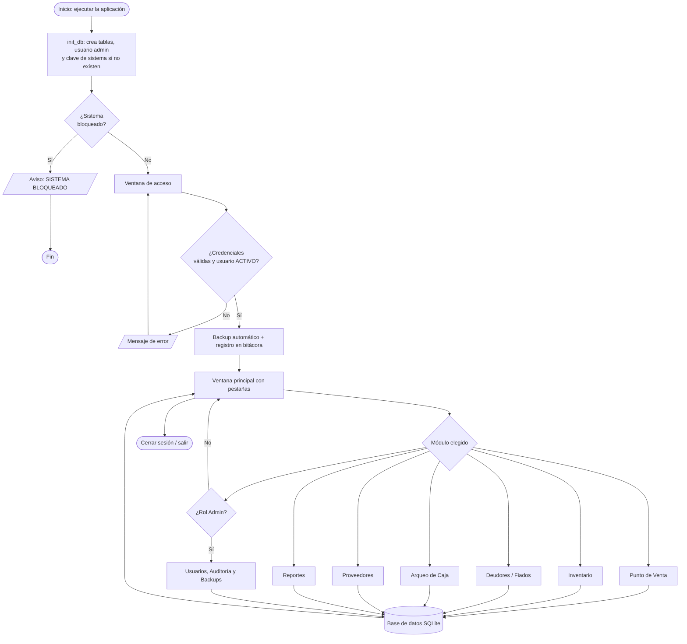
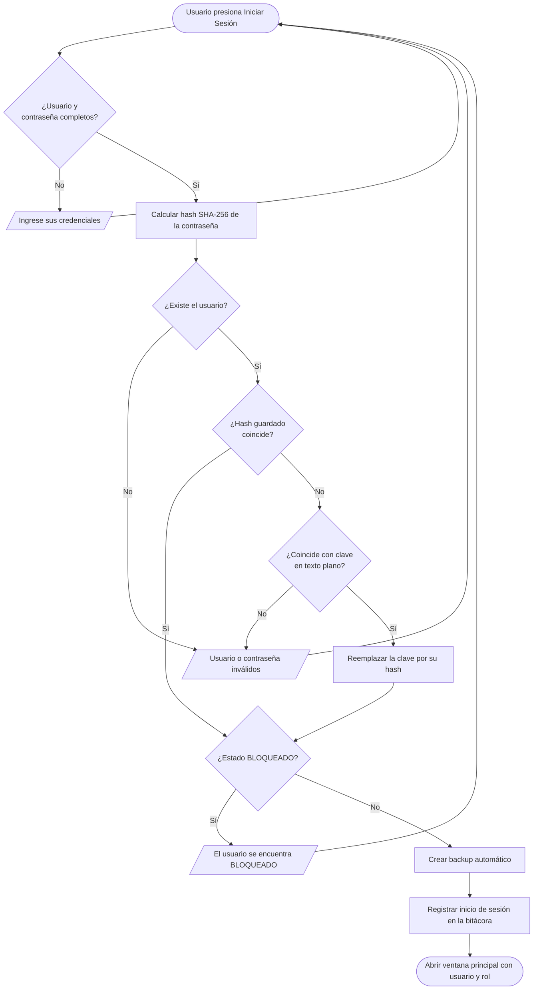
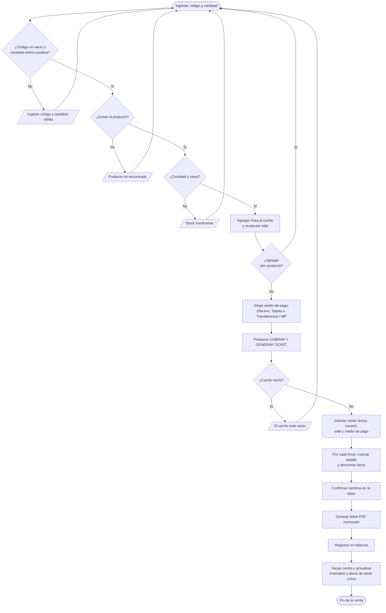
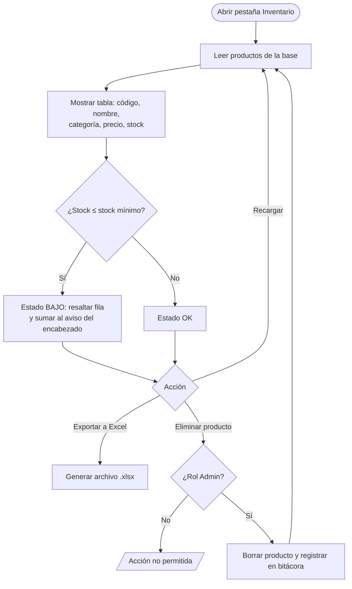
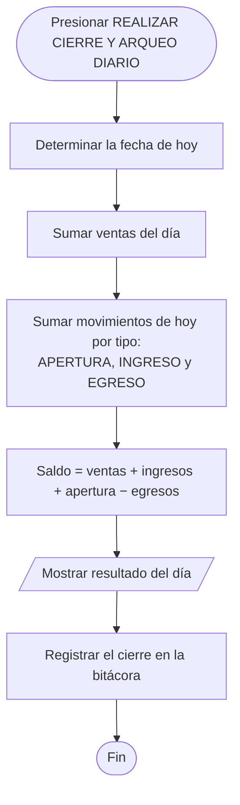
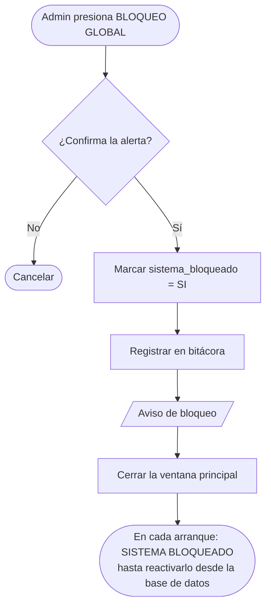

# Diagrama de flujo de SANDUINO Energy ERP

Los diagramas están escritos en [Mermaid](https://mermaid.js.org/), que GitHub dibuja directamente en esta página.

## 1. Flujo general del sistema

## 2. Inicio de sesión

## 3. Venta en el Punto de Venta

## 4. Inventario y alerta de stock

## 5. Cierre de caja

## 6. Bloqueo global de emergencia

